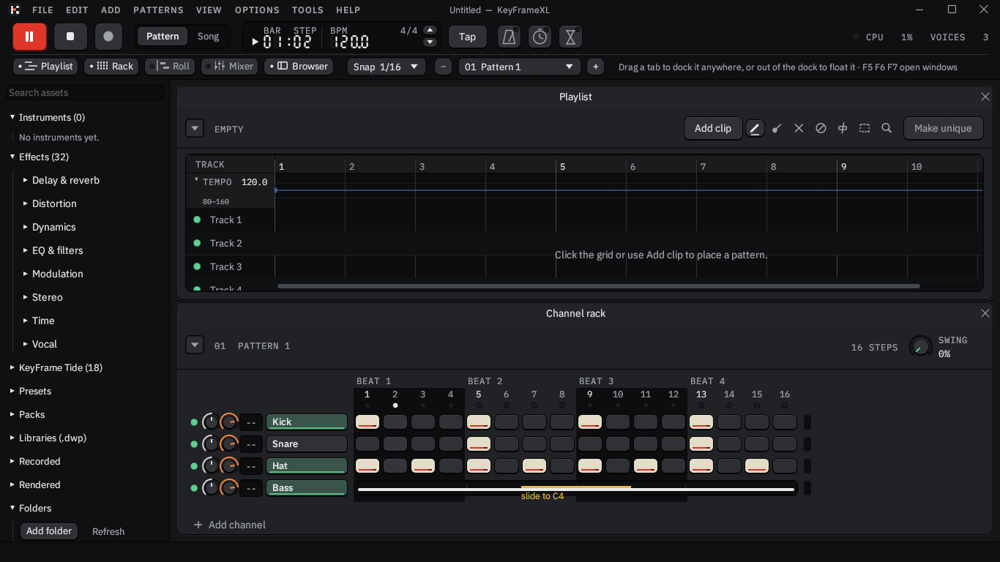

<p align="left">
  
</p>

# KeyFrameXL

> [!IMPORTANT]
> **This application is vibecoded.**
> KeyFrameXL is an experimental native Linux DAW and pattern sequencer built through AI-assisted vibecoding. Expect rough edges, rapid iteration, and unconventional internals — use it for experimenting, making beats, and exploring ideas, not as a battle-tested studio replacement.

**KeyFrameXL** is a native Linux pattern-based music sequencer and audio workstation written in Rust (`eframe`/`egui` + `egui_dock`), inspired by classic pattern-centric DAW workflows and tactile hardware sequencers.



## Features

### Sequencing & Arrangement
- **Channel Rack (`F6`)** — step sequencer with beat groups, per-step velocity (Shift+click), mute/solo, step operations, and inline note previews.
- **Piano Roll (`F7`)** — chromatic MIDI note editor with Draw (`P`) and Slide (`S`) tools, snapping (`1/16`, `1/4`, `Bar`, or free with `Alt`), scale highlighting, velocity lane, note tools, and a built-in **Riff Machine**.
- **Playlist (`F5`)** — multi-track arrangement for pattern and audio clips, **Tempo automation lane**, and **Automation clips**.
- **Dockable Workspaces** — every editor is a tab that can be docked side-by-side, stacked, or floated into its own window. Three workspace presets (`Arrange`, `Compose`, `Edit` via `Alt+1..3`) persist to `~/.config/keyframexl/workspace.ron`.

### Built-in Instruments
- **Multi-zone Sampler** — DirectWave-inspired sampler with key/velocity zone mapping, DAHDSR envelopes, forward/sustain/ping-pong loops, dual filters, dual LFOs, and a 16-slot modulation matrix. Imports DirectWave `.dwp` presets (via optional ConvertWithMoss).
- **KeyFrame Tide** — built-in polyphonic synthesizer with 18 factory presets.
- **Forge (Game SFX Designer)** — procedural sound designer for jumps, coins, hits, lasers, and explosions with up to 6 layers (oscillators, noise, samples, Tide synth), drawn pitch/volume/filter curves, 4 character knobs (*Size, Energy, Dirt, Space*), style presets (*Retro, Cartoon, Heavy, Sci-fi*), **Mutate** variations, and batch WAV/OGG export. See [docs/forge.md](docs/forge.md).
- **Vocal (UTAU Singing Channels)** — singing synthesis powered by the WORLD vocoder (`rsworld-sys`) using UTAU voicebanks (including one-click official Kasane Teto download) with per-note lyrics directly in the piano roll. See [docs/vocal.md](docs/vocal.md).

### Mixer & 32 Built-in Effects
The Mixer (`F9`) ships with **32 native DSP effects** with custom visual faces and A/B presets:
- **EQ & Filters:** Parametric EQ 2, 3-band EQ, Tilt EQ, Filter
- **Dynamics:** Compressor, Multiband Compressor, Limiter, Squeeze, Soft Clipper, Noise Gate, Transient Shaper
- **Delay & Reverb:** Reverb, Room Reverb, Convolution Reverb, Bloom, Delay, Stereo Delay
- **Distortion & Color:** Drive, Wavefolder, Bitcrusher
- **Modulation & Time:** Chorus, Hyper Chorus, Phaser, Tremolo, Auto Pan, Ring Modulator, Time
- **Stereo & Vocal:** Stereo, Stereo Shaper, Mid / Side, Balance, Vocoder

### Plugin Hosting & FL Studio Interop
- **VST3 & VST2 Hosting** — out-of-process plugin bridge (`src/bridge/`) to isolate crashes, embedded X11 editor windows, and Wine/yabridge support for Windows plugins.
- **FL Studio Interop** — imports `.flp` projects (`src/flp.rs`, `src/flp_fx.rs`), plus optional FL Link / channel freezing workflows.

### Audio, MIDI & Export
- **Shared Engine** — real-time playback (PipeWire/ALSA via `cpal`) and offline rendering share one voice engine (`src/engine.rs`).
- **MIDI & Recording** — live MIDI input (`midir`), MIDI file import/export, and in-app audio recording.
- **Portable Projects & Export** — saves self-contained `.kfxl` project files and exports to **WAV** (16/24-bit, 32-bit float), **FLAC** (16/24-bit), and **MP3** (128/192/320 kbps), plus WAV/OGG batch export in Forge.

## Quick Start

### Prerequisites (Linux)
- **Rust** (Edition 2024 / recent stable toolchain)
- **ALSA development libraries** (`libasound2-dev` on Debian/Ubuntu, `alsa-lib` on Arch, `alsa-lib-devel` on Fedora)
- **C/C++ build toolchain & pkg-config** (for native crates such as `rsworld-sys`)
- Working **PipeWire** or **ALSA** audio output

### Build & Run

```sh
# Run with the demo beat & bass slide
cargo run -- --demo

# Run an optimized release build (recommended for live playback & DSP)
cargo run --release

# Open an existing KeyFrameXL or FL Studio project directly
cargo run --release -- path/to/project.kfxl
cargo run --release -- path/to/project.flp
```

### Useful CLI Commands

```sh
# Render the built-in demo directly to WAV
cargo run -- render-demo demo.wav

# Play the built-in demo via PipeWire (pw-cat)
cargo run -- play-demo

# Scan VST3 folders and print plugin status
cargo run -- plugin-scan
```

## Keyboard Shortcuts

| Shortcut | Action |
| --- | --- |
| `Space` | Play / Stop (with rewind) |
| `Ctrl+Space` | Pause in place |
| `L` | Switch Pattern / Song mode |
| `F5` / `F6` / `F7` / `F9` | Open or focus Playlist / Channel Rack / Piano Roll / Mixer |
| `Alt+F8` | Show / hide Browser |
| `Alt+1` / `Alt+2` / `Alt+3` | Switch Workspace (`Arrange` / `Compose` / `Edit`) |
| `Ctrl+Z` / `Ctrl+Y` | Undo / Redo |
| `Ctrl+Shift+N` / `Ctrl+O` / `Ctrl+S` | New / Open / Save project |
| `Ctrl+Shift+S` | Save As |
| `Ctrl+Shift+Ins` | New pattern |
| `P` / `S` (Piano Roll) | Draw tool / Slide note tool |

## Optional Integrations

- **DirectWave `.dwp` presets:** install [ConvertWithMoss](https://www.mossgrabers.de/Software/ConvertWithMoss/ConvertWithMoss.html) (20.2+) in `PATH` or set `KEYFRAMEXL_CONVERTER` to its executable. Once imported, samples and zone settings are embedded inside the `.kfxl` project.
- **Windows VST plugins:** configure Wine / yabridge paths in **Options → Settings → Plugins**. Native X11 window embedding is enabled automatically (via XWayland on Wayland sessions; override with `KFXL_X11=0`).
- **UTAU voicebanks:** install `.zip` voicebanks or use the built-in one-click installer inside a Vocal channel.

## Project Structure

```text
assets/          App icon, brand lockup SVG, bundled IBM Plex fonts
docs/            Feature guides (Forge, Vocal, UI rules, roadmap, DWP validation)
scripts/         Fixture generators and live/UX helper scripts
src/
  bridge/        Out-of-process VST plugin host & shared memory protocol
  forge/         Procedural game SFX synthesizer & batch exporter
  fx/            32 built-in native audio effects + presets
  ui/            egui/eframe shell, dockable editors, custom widgets
  vocal/         UTAU voicebank parser, lyric mapper, WORLD vocoder renderer
  engine.rs      Shared real-time & offline audio engine
  flp.rs         FL Studio .flp project importer
  sampler.rs     Multi-zone sampler engine
  synth.rs       KeyFrame Tide synthesizer
tests/           Integration tests and audio fixtures
vendor/          Patched local dependencies (cpal, egui_dock, vst3-host, winit)
```

## Documentation

- [Forge — Game SFX Designer](docs/forge.md)
- [Vocal — UTAU Singing Channels](docs/vocal.md)
- [UI Rules & Component Reference](docs/ui-rules.md)
- [Roadmap](docs/roadmap.md)
- [DirectWave (DWP) Validation](docs/dwp-validation.md)

## License

MIT — see `Cargo.toml`.
